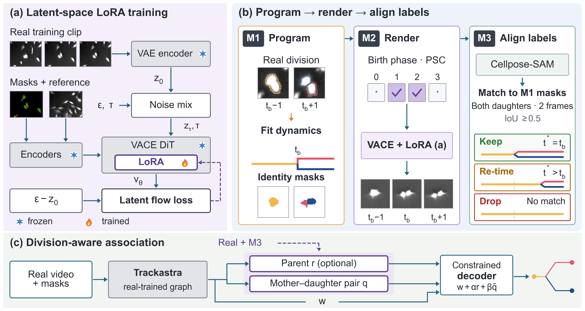
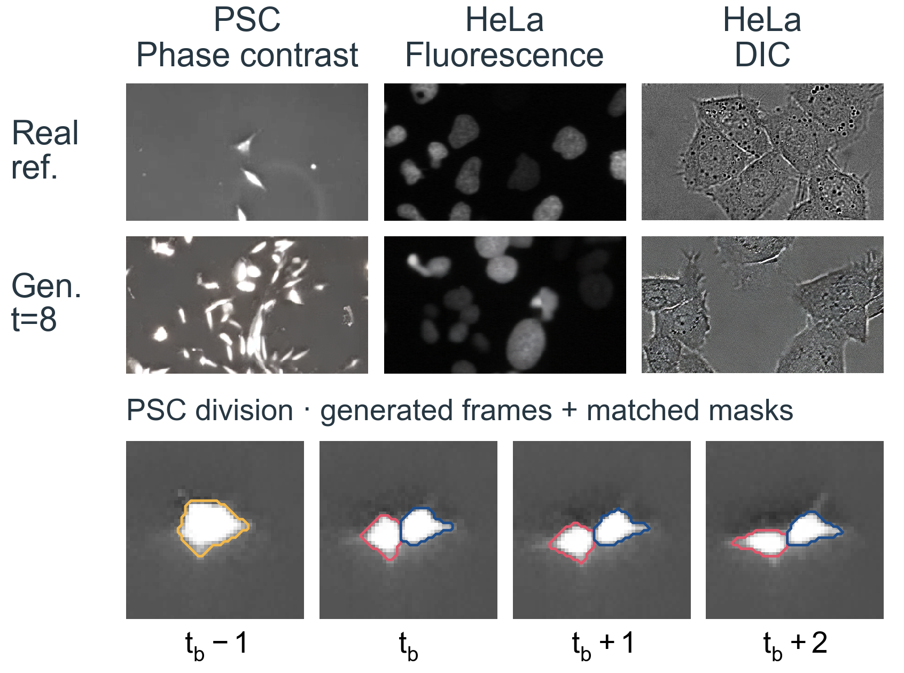

# MitoSync

**Programmable Division Supervision for Division-Aware Cell Tracking**

Yunshu Chen · Zhenhua Chen · Deval Mehta · Litao Yang · Zongyuan Ge

[Paper](paper/MitoSync.pdf) · [Method](docs/METHODS.md) · [Reproduce the results](docs/REPRODUCING.md) · [Data and models](docs/DATA.md)

MitoSync combines exchange-invariant mother–daughter scoring with joint division
and continuation decoding. A complementary pipeline programs cell divisions,
renders microscopy video and aligns supervision with detected events.



## Main results

On the two CTC evaluation sequences, the full model with MitoSync supervision
improves sparse division F1 by **5.25 points on PSC** and **7.93 points on Fluo**
relative to the Trackastra graph reference. On 36 external LFCT fields, the frozen
real-only pair model improves sparse event F1 by **4.05 points**. These are system
comparisons; they are distinct from gains due to synthetic training.

Controlled experiments separate association, rendering, label alignment and
sampling effects. Joint scoring and decoding provide the clearest tracking
improvement. Synthetic supervision helps in some fixed-model settings, while
direct painting remains competitive. The paper reports all controls, including
null and negative outcomes.

CTC video 01 participated in earlier development, so those comparisons are
retrospective. LFCT uses a different event metric; its absolute scores are not
directly comparable to CTC BC(0). Full definitions are in [Methods](docs/METHODS.md).

## Quick start: verify the released evidence

```bash
python -m venv .venv
source .venv/bin/activate
python -m pip install -r requirements-audit.txt
python scripts/verify_release.py
```

The verification runs on CPU, checks released file hashes and configurations,
recomputes **14,580 per-view records**, and runs **20 input, inference and metric
tests**. It does not require pretrained weights or microscopy images.

For generation and model-training source, start with [Code guide](docs/CODE.md).
Model checkpoints and the complete generated corpus are planned as separate
downloads; they are not bundled or silently downloaded by this command.

## Generated examples



Top: real references and generated images in phase contrast, fluorescence and
DIC. Bottom: one generated PSC division with aligned masks. DIC is a qualitative
example; tracking evaluation uses PSC and Fluo.

## Repository contents

| Path | Contents |
|---|---|
| `code/mitosync/`, `code/vace/` | Division programming, rendering, painting and label alignment |
| `reproducibility/` | Pair model, decoder, training and inference source, metrics, raw evaluation counts and tests |
| `configs/` | 20 Trackastra configuration pairs and four fitted parent normalization files |
| `results/` | Machine-readable versions of the three paper tables |
| `paper/` | Current manuscript and compilable LaTeX source |
| `docs/`, `environments/` | Input definitions, evaluation protocol, usage and recorded environments |

## Citation

Please cite the manuscript when using this work; see [CITATION.cff](CITATION.cff).
No proceedings DOI is assigned in this repository.

## Availability and licenses

Source and compact evaluation materials are provided here. Generated datasets and
trained checkpoints will be added through versioned download links; see
[Data and models](docs/DATA.md) for what is currently included. Third-party code
retains its original licenses in [NOTICE](NOTICE) and `licenses/`. A project-wide
reuse license has not yet been assigned.
